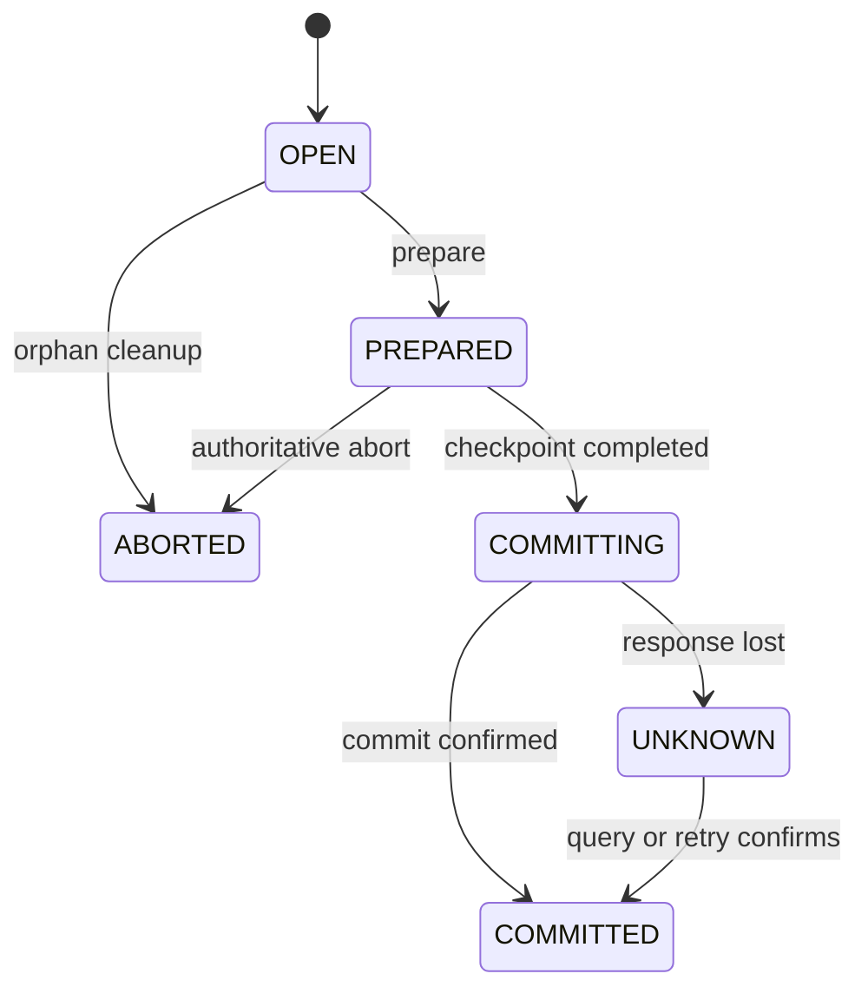

Kafka 分区 P0 的下一条记录是给 Alice 的账户加 50。余额已经加过，读取位置却退回这条记录之前，故障恢复就会再加一次。反过来，位置推进了，余额还没保存，这 50 就丢了。单看 Offset 和余额，两边都可能保存成功。

我用这个账户聚合任务读 [Flink 状态管理论文](https://www.vldb.org/pvldb/vol10/p1718-carbone.pdf)。前半篇沿着 2017 年论文的 Algorithm 1 走一遍双输入对齐，再看 Flink 2.3 怎样处理在途数据和大状态。最后把同一组故障放到事务 Sink 和 SeaTunnel Connector 上，看看引擎能保证什么，哪些结果还要由目标系统确认。

## 一、一致性问题：恢复点必须解释同一段历史

Checkpoint 41 中，`alice=900`，P0 的 `nextOffset=121`，即下次要读 Offset 121。处理 `P0@121: +50` 后，有两组合法的恢复位置。

| 恢复时的 nextOffset | 恢复时的余额 | 处理恢复输入后的余额 |
| ---: | ---: | --- |
| 121 | 900 | 重放 +50，得到 950 |
| 122 | 950 | 从下一条继续，仍是 950 |
| 121 | 950 | 重放 +50，错误地得到 1000 |
| 122 | 900 | 跳过 +50，少算 50 |

一致性要求位置和状态覆盖同一段输入。分布式任务还要解释两件事：上游已经发出、下游尚未处理的记录在哪里；哪些输出已经在外部可见。把余额存进可靠的数据库只能保住这个数值，无法从数值推断对应的 Kafka Offset 或 Sink 事务。

## 二、Managed State：运行时究竟管理什么

| 状态 | 所有权与恢复方式 |
| --- | --- |
| Keyed State | 余额、窗口和定时器跟随业务 key，由 key-group 分配到 Subtask。 |
| Operator State | 分区 Offset、Source Split 等跟随算子实例，扩缩容按 list、union 等约定重分。 |
| 外部未决事务 | Connector 持久化事务身份，由恢复后的 Writer 或 Committer 接管。 |

`maxParallelism` 决定 key-group 总数，当前并行度决定每个 Subtask 分到哪些组。服务升级时，Flink 还需要 Operator UID 来找到算子、State Name 来找到状态、Serializer Snapshot 来判断旧数据是否可读。依赖 Job Graph 自动生成的 ID，改图后可能匹配不到旧状态。Connector 里的普通成员字段、静态 Map、后台线程 Buffer 也要单独安排恢复，运行时不会自动发现它们。

## 三、论文的 Snapshot Model 与三个显式假设

本文把 Checkpoint N 的边界定在 Barrier N 处：每个输入上，Barrier 之前的记录属于 N，之后的记录留给下一个 Epoch。论文称这个控制消息为 Marker。Source 在同一个有序边界记录读取位置并把 Marker 放进数据流。

论文 §3.2.2 的 fail-recovery、确定性处理模型有三个前提：

1. Source 可以从一个持久位置重放输入。
2. Task 间通道可靠且 FIFO，支持阻塞和恢复。阻塞期间由系统缓冲在途消息，必要时写盘。
3. Task 可以控制输入通道，并向输出发送记录和 Marker。

论文还约定 Marker 和普通记录由调用用户算子的同一底层线程顺序处理。这决定了本地边界两侧有哪些状态更新。若用户函数读取未记录的系统时间、随机数或外部服务，重放同一条输入仍可能产生不同输出。

## 四、Barrier Alignment：逐条记录推演一致切面

### 一个双输入账户聚合的完整时间线 {#42-一个双输入账户聚合的完整时间线}

现在加上第二个账户。CP41 中 `(alice, bob) = (900, 300)`，两个分区的后续输入如下，A 的 Barrier 先到。

```text
A: P0@121 alice +50 → Barrier 42 → P0@122 alice +100
B: P1@81  bob   −20 → Barrier 42 → P1@82  bob   +200
```

| 到达事件 | 算子动作 | 在线余额 (alice, bob) |
| --- | --- | --- |
| A 的 +50 | 更新 Alice | (950, 300) |
| A 的 Barrier 42 | 阻塞 A，继续读 B | (950, 300) |
| A 的 +100 到达通道 | 缓冲这条记录，暂不调用用户函数 | (950, 300) |
| B 的 −20 | 更新 Bob | (950, 280) |
| B 的 Barrier 42 | 所有输入到齐，固定 CP42 对应的状态 | **(950, 280)** |
| 输入恢复，处理 +100 和 +200 | 两笔更新都属于下一轮 | (1050, 480) |

如果 A 收到 Barrier 后继续把 +100 交给用户函数，CP42 中的 Alice 可能变成 1050，但对应的 Source 位置仍是 122。恢复后再读 `P0@122`，余额就会变成 **1150**。对齐的作用正是隔开这条已经到达、却属于下一轮的记录。

### Algorithm 1 到底做了什么 {#43-algorithm-1-到底做了什么}

论文中，Task 收到 Marker 后阻塞对应输入。全部到齐时，依次向输出发送 Marker、调用 `triggerSnapshot()`、解除输入阻塞。先传播 Marker 能让下游继续建立自己的边界；本地仍要同步固定一个稳定视图，随后才能一边处理新记录，一边异步写出旧视图。这个顺序描述论文算法，现代 Flink 各版本、各类算子的具体调用顺序需看对应实现。

### 从本地状态到 Completed Checkpoint {#45-从本地状态到-completed-checkpoint}

在 FIFO 的普通 DAG 中，每条输入的旧记录都先于 Marker 被处理，早到 Marker 的通道又拦住了新记录。普通网络队列可以继续流动，无须在这份对齐快照里再保存一次。论文里的有环拓扑多了一步：旧记录可能仍在环中流转，`IterationHead/IterationTail` 为环内必要的在途消息保留日志，直到 Marker 绕回。

Task 完成物化后提交 State Handle 和 ACK。Coordinator 收齐计划内所有参与者的 ACK，把 Pending Checkpoint 确认为 Completed，才能用它恢复。单个 Task 已经写完的文件不能与别轮状态拼接；全局耗时取决于重叠执行的传播、对齐和物化中最慢的关键路径。

## 五、什么时候必须保存 Channel State

| 模式 | 怎样处理快照边界附近的记录 | 恢复语义 |
| --- | --- | --- |
| 论文中的 aligned，普通 DAG | 阻塞先到 Marker 的输入，旧记录先处理完 | 算子状态 exactly-once |
| 论文中关闭 Alignment | 通道继续消费，边界后的更新可能进入快照 | at-least-once |
| 现代 Flink 的 unaligned | Barrier 越过排队数据，把必要的输入、输出 Buffer 写入 Channel State | 算子状态仍可 exactly-once |
| 论文中的有环拓扑 | 对环内无法排除的旧消息做局部日志 | 算子状态 exactly-once |

### 现代 Unaligned Checkpoint 用 I/O 换等待时间 {#52-现代-unaligned-checkpoint-用-io-换等待时间}

Unaligned 让 Barrier 更快通过背压区域，代价是要写出、恢复它越过的 Buffer。如果慢在单条用户函数或 Checkpoint Storage 写入，改成 unaligned 帮助有限，额外的 Channel State 还会争用 I/O。

按 Flink 2.3 文档，unaligned 使用 `EXACTLY_ONCE` 模式，不支持多个 unaligned checkpoint 并发；pointwise、broadcast 等相应连接会禁用该路径。配置 alignment timeout 时，按本轮 Checkpoint 触发后的已用时间决定是否切换。Barrier 不能抢占正在执行的单条记录；恢复后，Watermark 与在途数据原有的隐式顺序也可能改变。Savepoint 始终 aligned。

## 六、状态怎样物化：Backend、Storage 与增量 SST

### 同步阶段只固定稳定视图 {#62-同步阶段只固定稳定视图}

在账户例子里，即使在线余额已是 `(1050,480)`，后台写出的 CP42 仍必须是 `(950,280)`。把可变 Map 的引用交给后台上传会破坏这个前提。Backend 需要用 Copy-on-Write、不可变版本或 RocksDB Snapshot 等方式先固定视图，再让前台继续消费。

Flink 自 1.13 起明确区分 State Backend 和 Checkpoint Storage。前者管理在线状态及快照视图，后者保存快照字节和元数据。例如，本地 RocksDB 的检查点可以写到 S3，在线 `state.get()` 仍读本地。2.3 的文档还列出 HashMap、Embedded RocksDB 以及实验性的 ForSt；论文里的 External State Backend 指在线状态访问由外部 KV 或数据库承载。

### 增量 Checkpoint 的真实对象是共享文件 {#63-增量-checkpoint-的真实对象是共享文件}

RocksDB 可复用不可变的 SST 文件。设三轮快照分别引用：

```text
C100 = {A, B, C}
C101 = {A, B, D}
C102 = {B, D, E}
```

C101 通常只上传新文件 D 和元数据，恢复时却需要 **A、B、D 全部三个文件**。删除 C100 后，C 没有其他引用才可回收，A 和 B 仍应保留。Compaction 会生成新的 SST，即使逻辑数据量变化很小，本轮上传量也可能突增。

所以增量模式的 `Checkpointed Data Size` 反映本轮 delta。评估恢复开销还要看文件数、下载吞吐、IOPS 和 Backend 初始化。异步物化、增量上传与本地恢复各自优化不同阶段。

## 七、故障恢复与端到端 Exactly-Once：用一个事务走完所有窗口

### Completed Checkpoint 保存的是一个恢复元组 {#71-completed-checkpoint-保存的是一个恢复元组}

假设 CP41 之前的输出都已提交。处理 Alice 的 +50 和 Bob 的 −20 后，Sink 在 CP42 的 Barrier 处准备 T42，将稳定事务句柄纳入状态。两个分区的位置、算子状态和未决输出应能一起找回：

```text
CP42 = {
  sourceProgress: (P0.nextOffset=122, P1.nextOffset=82),
  operatorState:  (alice=950, bob=280),
  pendingSink:    T42
}
```

即使各 Task 已经把这些字节写到磁盘，恢复者仍需 Coordinator 持久化的完成决定以及对应的 State Handle。只有确认 CP42 已完成，Sink 才应提交 T42；此时事务本身可能仍处于 PREPARED。

### Sink 需要的是可恢复状态机，不是一次 flush {#72-sink-需要的是可恢复状态机不是一次-flush}



`flush()` 可以清空 Buffer、等待异步请求，不能替目标库作提交决定。Barrier 到达时要等在途请求完成或隔离旧请求，并保存 pending 句柄。恢复者须能按稳定 ID 查询事务结果，或安全地重试提交、清理；新执行还要隔离旧 Writer。完成通知可能遗漏，也可能由更高编号的完成点覆盖。确认 N 完成时，要能处理直到 N 为止仍应提交的事务，并在结果确认后再删除句柄。

### 五个失败窗口怎样收敛 {#73-五个失败窗口怎样收敛}

| 故障位置 | 恢复点与输入 | 恢复后的外部动作 |
| --- | --- | --- |
| CP42 触发前 | 从 CP41 的 (121,81) 重放 | 中止或隔离遗留的 OPEN 事务 |
| T42 已 prepare，CP42 未完成 | 仍恢复 CP41，重算 +50 和 −20 | 保持 T42 不可见，中止、超时清理或隔离它 |
| CP42 已完成，通知丢失 | 恢复 CP42，从 (122,82) 继续 | 找回 pending T42，补做提交 |
| T42 已提交，响应丢失 | 仍恢复 CP42 | 按原事务 ID 查询或幂等重试，确认同一次提交 |
| CP42 后处理了新数据，CP43 未完成 | 回滚到 CP42，重放新数据 | 隔离新一轮的旧事务，由有效 Writer 接管重放 |

最后两行区分了“执行次数”和“最终效果”。`P0@122` 可以被执行两次，第一次产生的在线状态回滚、外部事务得到隔离，最终仍只生效一次。若用幂等 Upsert 实现，除稳定主键外，还需要确定的写入值，并防止旧版本覆盖新版本。旧 `TwoPhaseCommitSinkFunction` 的回调和现代 Sink V2 的 Writer、Committable、Committer 都要回答上述故障问题，具体调用接口则不同。

## 八、Rescale、Savepoint 与现代运行时职责

### Rescale 实际上怎样读取旧 State Handle {#81-rescale-实际上怎样读取旧-state-handle}

令 `M=maxParallelism=12`。并行度由 3 调到 4 时，key-group 总数不变：

| 并行度 | 各 Subtask 负责的 key-group |
| --- | --- |
| 3 | [0..3]、[4..7]、[8..11] |
| 4 | [0..2]、[3..5]、[6..8]、[9..11] |

新的 subtask-1 因而要从旧 subtask-0 的 Handle 取组 3，再从旧 subtask-1 取组 4 和 5。把某一个旧 Subtask 的本地数据库整个搬过去，无法得到这个范围。Source Split 等 Operator State 要按 list/union 约定重分；事务接管则依靠稳定身份。

### Checkpoint 与 Savepoint 共用基础设施，但合同不同 {#82-checkpoint-与-savepoint-共用基础设施但合同不同}

Checkpoint 服务于自动恢复，通常由 Flink 清理，可用 Backend 原生的增量格式。Savepoint 由用户显式持有，服务于停机、升级和迁移，默认 canonical，也可选 native。两种快照恢复都要检查 UID、状态名、序列化兼容性、`maxParallelism` 和 Connector 的 pending 状态。例如 CDC Source 恢复所需的信息可能包括 Enumerator 状态、Split 分配、每个 Split 的位置，以及 Snapshot 到 Log 的切换阶段；一个 Offset 解释不了所有进度。

## 九、King 生产数据：论文到底证明了什么

King 的 Rule-Based Event Aggregator 将查询规则广播到算子，事件按用户 ID 分区。业务规模超过 3.5 亿月活、300 亿事件/天。论文观察了 5 个生产部署：共享 YARN 集群有 18 台物理机，每台 32 核、378 GB RAM，Flink 1.2.0 的 RocksDB 放在本地 SSD，Checkpoint 写到 HDD 支撑的 HDFS。

状态规模实验采用并行度 70，全局状态约 100–500 GB。论文给出的平均 **1.3 秒是 Alignment Delay**。用这个数字估算 500 GB 状态上传时间，会把排队对齐、异步写盘和全局确认混成一个指标。实验范围内，状态增长未带来明显的对齐延迟增长；它没有测量大规模恢复 P99、对象存储尾延迟或现代 unaligned 模式。

### Checkpoint 变慢时看哪一层 {#92-checkpoint-变慢时看哪一层}

| 时间或指标变大 | 先查什么 |
| --- | --- |
| Start Delay / Alignment | 前者看首个 Barrier 之前的背压与慢 Subtask；后者比较多个输入的 Barrier 到达差和热点。 |
| Sync Duration | 任务线程上的序列化、Copy-on-Write、GC。 |
| Async Duration / 增量 delta | 前者看本地盘、网络和存储限流；后者看 SST 新增与 Compaction。 |
| Unaligned Channel State | 队列积压是否已经转成存储 I/O，存储余量是否足够。 |
| Restore | 文件数、下载速率、Backend 初始化与 Source 重放量。 |

## 十、对 SeaTunnel/Zeta 与 Connector 的工程推论

以下是把上述故障窗口用于审视 SeaTunnel 的方法。Flink 的类名、Checkpoint 模式和运行时承诺，不能直接套到某个 Zeta 版本。

### 跨越 Checkpoint 边界的东西必须有去处 {#101-跨越-checkpoint-边界的东西必须有去处}

Source 保存的位置要对应它在 Barrier 前**按序发出**的记录。Aligned 模式下，这些记录当时仍可能在网络中，FIFO 和下游对齐会守住边界。审查引擎队列时，我会问：失败后由谁重放、谁恢复，或者 Barrier 前是否已排空？最危险的是进度已经前移，队列中的记录却既未入状态也无人重放。

Sink 的异步请求同理。可以等待或隔离在途请求、保存请求身份、按幂等键重试，或由事务统一 prepare；关键是避免 Source 已跳过该批输入，而 Sink 在恢复中丢掉这批写入。

### 后台线程必须服从 Epoch Fence {#102-后台线程必须服从-epoch-fence}

[Engine-Level FlushSignal 一文]()里讨论过 Connector 的定时线程。到了 Checkpoint 边界，还要固定 pending Buffer，明确异步异常怎样传回 Task，禁止旧 Writer 在新执行接管后继续写。事务 ID 若只取自 `workerId/taskIndex`，Failover 或 Rescale 后可能无人认领旧事务。多个 Writer 即使各自能正确重试，也不能据此推断目标系统提供跨分区原子可见性。

### E2E 测试要控制协议阶段，而不是控制时间 {#103-e2e-测试要控制协议阶段而不是控制时间}

我最想守住的是 T42 已在目标端提交、ACK 却没有返回的窗口。用测试服务端在持久提交后暂停响应，等它确认到达该点再杀掉提交者，能确定故障究竟发生在哪一步：

```java
commitServer.pauseAt(AFTER_DURABLE_COMMIT_BEFORE_ACK);
job.triggerCheckpoint(42);
commitServer.awaitPaused(42);
job.killCommitOwner();

job.restartFromLatestCompletedCheckpoint();
commitServer.resume();
assertThat(commitServer.logicalCommitCount(42)).isEqualTo(1);
assertThat(target.rows()).containsExactlyInAnyOrderElementsOf(expectedRows);
```

这是协议测试的伪代码。恢复路径若选择幂等补交，再断言 T42 的提交调用至少两次；若按事务 ID 查询，则验证它确认了原提交。只比较最终行数会漏掉旧值覆盖新值，也看不出是否真的经过了模糊提交窗口。

## 参考资料

1. Paris Carbone et al., [State Management in Apache Flink: Consistent Stateful Distributed Stream Processing](https://www.vldb.org/pvldb/vol10/p1718-carbone.pdf), PVLDB 10(12), 2017.
2. Apache Flink 2.3, [Checkpointing](https://nightlies.apache.org/flink/flink-docs-release-2.3/docs/dev/datastream/fault-tolerance/checkpointing/).
3. Apache Flink 2.3, [Checkpointing under backpressure](https://nightlies.apache.org/flink/flink-docs-release-2.3/docs/ops/state/checkpointing_under_backpressure/).
4. Apache Flink 2.3, [State Backends](https://nightlies.apache.org/flink/flink-docs-release-2.3/docs/ops/state/state_backends/).
5. Apache Flink 2.3, [Checkpoints vs. Savepoints](https://nightlies.apache.org/flink/flink-docs-release-2.3/docs/ops/state/checkpoints_vs_savepoints/).
6. Apache Flink 2.3, [Tuning Checkpoints and Large State](https://nightlies.apache.org/flink/flink-docs-release-2.3/docs/ops/state/large_state_tuning/).
7. Apache Flink 2.3, [Fault Tolerance Guarantees of Data Sources and Sinks](https://nightlies.apache.org/flink/flink-docs-release-2.3/docs/connectors/datastream/guarantees/).
8. Apache Flink 2.3, [Deprecated API List](https://nightlies.apache.org/flink/flink-docs-release-2.3/api/java/deprecated-list.html).
9. Apache Flink 2.3, [CheckpointListener API](https://nightlies.apache.org/flink/flink-docs-release-2.3/api/java/org/apache/flink/api/common/state/CheckpointListener.html).
10. Apache Flink 2.3, [SupportsCommitter API](https://nightlies.apache.org/flink/flink-docs-release-2.3/api/java/org/apache/flink/api/connector/sink2/SupportsCommitter.html).
