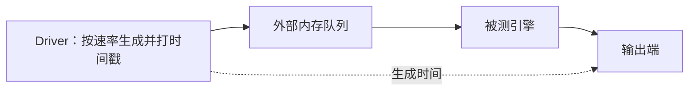

假设一次微基准跑出 `baseline 102.0 ns/op`、`candidate 98.5 ns/op`。差了 3.5 ns。要判断这是不是一次优化，我想先看每个独立 JVM 的结果：有多少进程复现了这个差异？它是否只出现在预热阶段？

换成流处理作业，我会先查计时起点。一条事件进入 Source 前已经排队 30 秒，即使引擎内部的 P99 只有 20 ms，消费者照样拿到了一条迟到的数据。下面三篇论文讲的，分别是怎样取样、怎样分配实验时间，以及怎样把这 30 秒测出来。

## 一、三个决定实验结果的问题 {#一三篇论文精读从测得准到测得对}

### 1.1 同一个 Java 程序，要重启几次 JVM？ {#11-2007java-性能不是一个常数}

Georges、Buytaert 和 Eeckhout 在《Statistically Rigorous Java Performance Evaluation》（OOPSLA，2007）中调查了 50 篇 Java 性能论文，其中 16 篇没有交代实验方法，10 篇取最好值，只有 4 篇报告置信区间。取最好值特别容易偏爱波动大的实现。假设 A 通常用 100 ms，最快 98 ms；B 通常用 103 ms，偶尔达到 91 ms。仅凭最快的一次会选 B，但下一次普通运行很可能还是 A 更快。

实验单位由要测的生命周期决定：

| 想测什么 | 怎样取一个样本 |
| --- | --- |
| 启动性能 | 每次启动新 JVM，从相同起点运行一次任务，记录耗时。若关心命令行启动到完成的时间，计时器也要放在进程外。 |
| 稳定态性能 | 每个 JVM 执行多轮，保留进入目标阶段后的测量，在进程内先算均值，再比较各 JVM 的均值。 |

同一 JVM 中的迭代共享 JIT 编译结果、堆和 GC 历史。5 个 Fork 各测 10 轮，留下 50 个分数，进程级重复仍只有 5 次。以各 JVM 均值为样本，在独立性与分布假设合理时，可用 `x̄ ± t(0.975, n−1) × s/√n` 估计总体均值的 95% 置信区间。这里的 `n` 是 JVM 数；95% 描述同一套取样方法反复使用时的覆盖率。

作者测试了 Jikes RVM 的 5 种 GC、14 个 SPECjvm98 / DaCapo 基准、21 档堆大小和 3 个硬件平台，启动实验用了 30 次独立 JVM 运行。在这些组合里，简化汇总方法对启动性能给出的误导性结论最高约 16%，部分方法连快慢方向都判反，比例超过 3%。在稳态实验中，把 1% 设为最小关注差异时，部分方法的误导比例超过 20%。这些数字受工作负载、硬件和判定阈值约束。

这篇论文也留下了一个实际问题：怎样知道预热结束了？作者采用滑动窗口的变异系数（标准差除以均值）。最近几轮挨得很近，仍可能一起缓慢漂移。

### 1.2 一小时预算，应该多开 JVM 还是多测几轮？ {#12-2013严谨不等于把每一层都机械地跑很多次}

Kalibera 和 Jones 在《Rigorous Benchmarking in Reasonable Time》（ISMM，2013）中把重复分为构建（Build）、执行（Execution）和迭代（Iteration）三层。先固定硬件、JDK 和参数，交替或随机安排两个版本的执行顺序，再用一次定标实验估计各层的波动和成本。若总是先跑旧版本、再跑新版本，机器温度的变化也会被计入版本差异。

在固定构建、每个 Fork 测量相同轮数的简化模型中：

```text
Var(均值) ≈ σ²fork / F + σ²iter / (F × I)
```

`F` 是独立 Fork 数，`I` 是每个 Fork 的测量轮数。再加一轮只会缩小第二项。论文表 4 的一个例子很直观：在 P1 平台运行 `lusearch9`，Execution 层的相对变异是 30.3%，Iteration 层是 3.3%。在这台机器上继续测同一个 JVM，很难解释不同 JVM 为什么差这么多。如果重新构建也会改变二进制布局，还应在更高层重复 Build。换 JDK 或硬件后，要重新估计方差与成本。

**预热轮数也需要定标。** 作者对部分 DaCapo 组合最多执行 300 轮，结合运行序列图、滞后图和自相关函数，区分「初始化结束」和「后续样本近似独立」。表 3 中，P1 平台的几个结果如下，数字为迭代位置。

| Benchmark | 初始化结束 | 近似独立 | DaCapo 选择 | 滑动窗口 CoV 选择 |
| --- | ---: | ---: | ---: | ---: |
| avrora9 | 2 | 128 | 4 | 1 |
| lusearch9 | 3 | 5 | 5 | 247 |
| xalan6 | 2 | 2 | 29 | 未收敛 |

同一个 CoV 规则，在 `avrora9` 上过早停止，在 `lusearch9` 上一直等到第 247 轮。我会先画每个 Fork 的原始序列。若合理预算内始终看不到独立态，可以在各 JVM 中测同一个已初始化的位置，并写清这个位置。

版本比较最终要回答改善有多大。例如执行时间比 `candidate / baseline = 0.94`，95% 区间为 `[0.92, 0.97]`，对应的是耗时约减少 3%～8%。这是比值含义的示例，论文表格中的轮数也只适用于对应的实验环境。

### 1.3 加背压以后，延迟从哪里开始算？ {#13-2018流系统的最大输入速度不等于可持续吞吐}

Karimov 等在《Benchmarking Distributed Stream Data Processing Systems》（ICDE，2018）中把 Driver 放在独立机器上。Driver 按设定速率产生事件，在生成时打时间戳，先放进外部内存队列，再交给被测系统（SUT）。这样，引擎忙到读不动时，负载仍会到达，等待会出现在队列里。若压测端总等上一个请求结束才发下一个，最拥堵时本应到达的请求及其等待就被漏掉了，这就是 *coordinated omission*。



对单条事件，生成到输出的时间包含外部排队，摄入到输出的时间只覆盖引擎内部。窗口或 Join 的一条输出可能依赖多条输入，论文用贡献输入中最大的生成时间作为起点。假设三条输入的时间戳是 580、590、600，结果在 610 输出，则窗口输出延迟为 10。若业务关心最早那条事件等了多久，它等的是 30，需要单列指标。

论文从高负载开始逐步降低输入速率，同时观察队列积压与事件时间延迟。短时积压可以消化；如果在固定输入速率下积压和延迟持续增长，即使内部处理时间平稳，这个速率也超出了可持续吞吐。论文在 Storm 1.0.2、Spark 2.0.1、Flink 1.1.3 上比较了窗口聚合和 Join，也改变了集群规模、倾斜与输入波动。今天仍值得复用的是这个过载判据。

作者主动隔离了 Kafka、Redis 等外部组件，也没有在这些实验中评估 Exactly-once 成本、迟到数据或故障恢复。若目标是给一条生产链路定容量，消息队列、真实 Sink 和交付语义都应进入测试范围；跨机器的生成与输出时间戳也需要可比较的时钟。

### 1.4 把三个问题放进同一个实验 {#14-三篇论文真正连起来的主线}

以降低 SeaTunnel 一条记录的处理成本为例，我会先在 JVM 内比较两版代码，每个版本启动多个进程，保存各 Fork 的结果。随后在相同输入速率、分区、并发和 Sink 条件下重跑完整链路，记录吞吐、积压和端到端延迟。这两组实验各有自己的重复单位：前者是 JVM，后者是一次独立的作业运行。

## 二、JMH 怎样实现，以及四个典型使用场景

### 2.1 JMH 怎样为方法生成测量循环 {#21-jmh-不是用反射调用一次方法而是生成专用-harness}

在 OpenJDK JMH 1.37 中，`BenchmarkProcessor` 在编译时处理注解，`BenchmarkGenerator` 生成专用的 Harness 和 `BenchmarkList`。运行时，宿主进程的 `Runner` 解析选中的方法与参数，启动 Fork，由 `ForkedMain` 执行预热和测量。以平均时间模式为例，生成代码的核心可以写成下面的伪代码：

```java
long operations = 0;
long start = System.nanoTime();
do {
    blackhole.consume(benchmark(state));
    operations++;
} while (!control.isDone);
long elapsed = System.nanoTime() - start;
```

Harness 在循环外计时，再按操作数换算分数。真实实现还处理线程屏障、状态初始化、异常与返回值消费。一个方法若有返回值，直接返回计算结果，JMH 会消费它。

### 2.2 Fork、Warmup、Measurement 分别代表什么

一个 Fork 是新 JVM。预热迭代运行负载，其分数排除在最终结果之外；测量迭代在时间窗口内反复调用方法，产出迭代级分数。`@OperationsPerInvocation` 可以声明一次方法调用代表多少个逻辑操作，默认是一次。

| 模式 | 适合回答的问题 |
| --- | --- |
| `AverageTime` | 热路径一次操作平均用多久（如 ns/op）？ |
| `Throughput` | 指定线程数下每秒完成多少操作？ |
| `SampleTime` | 方法调用耗时的采样分布是什么？外部队列延迟另测。 |
| `SingleShotTime` | 单次调用或一批操作耗时多少？测冷初始化时要定义计时边界，关闭预热并重复开进程。 |

### 2.3 建立项目、运行与读懂输出

用 JMH 1.37 的 Maven 模板建立独立基准模块，下文示例放在 `src/main/java/org/example/`：

```bash
mvn archetype:generate -DinteractiveMode=false \
  -DarchetypeGroupId=org.openjdk.jmh \
  -DarchetypeArtifactId=jmh-java-benchmark-archetype -DarchetypeVersion=1.37 \
  -DgroupId=org.example -DartifactId=benchmark -Dversion=1.0
cd benchmark
mvn clean verify
java -jar target/benchmarks.jar -l
java -jar target/benchmarks.jar '.*HashBenchmark.*' \
  -f 5 -wi 5 -w 1s -i 10 -r 1s -rf json -rff target/jmh-result.json
```

该命令对每个参数组合启动 5 个 JVM；每个先预热 5 轮，再测量 10 轮，每轮 1 秒。下面是输出格式示例：

```text
Benchmark          Mode  Cnt   Score   Error  Units
HashBenchmark.mix  avgt   50  37.210 ± 0.880  ns/op
```

`Cnt = 50` 是 50 个测量迭代。这里的 `Error` 是 JMH 针对这组分数报告的 99.9% 均值置信区间半宽。它描述单个版本的测量，两个版本的耗时比需要单独估计。保留 JSON 中按 Fork 分组的 `primaryMetric.rawData`，才便于回看哪一组发生了漂移。

### 2.4 场景一：纯计算 {#24-场景一纯计算防止死代码消除与常量折叠}

整数混合函数的输入取自 State，输出交给 Harness。把类保存为同名 Java 文件；其余示例同理。

```java
package org.example;

import java.util.concurrent.TimeUnit;
import org.openjdk.jmh.annotations.Benchmark;
import org.openjdk.jmh.annotations.BenchmarkMode;
import org.openjdk.jmh.annotations.Mode;
import org.openjdk.jmh.annotations.OutputTimeUnit;
import org.openjdk.jmh.annotations.Param;
import org.openjdk.jmh.annotations.Scope;
import org.openjdk.jmh.annotations.State;

@State(Scope.Thread)
@BenchmarkMode(Mode.AverageTime)
@OutputTimeUnit(TimeUnit.NANOSECONDS)
public class HashBenchmark {

    @Param({"7", "42"})
    public int seed;

    @Param({"64", "1024"})
    public int rounds;

    @Benchmark
    public int mix() {
        int value = seed;
        for (int i = 0; i < rounds; i++) {
            value = Integer.rotateLeft(value * 31 + i, 5);
        }
        return value;
    }
}
```

`seed × rounds` 生成四组输入。若把调用写成 `void wrong() { mixConstant(42, 1024); }`，常量输入便于折叠，未使用的计算结果也可能被消除。示例的一个操作是完整跑完 `rounds` 次循环，读 `ns/op` 时要保留这个口径。

### 2.5 场景二：数据结构 {#25-场景二数据结构用-state-与生命周期隔离准备成本}

有序数组已经建好，一次查找花多少时间？用 `@Setup(Level.Trial)` 在测量窗口外准备数据。这个例子专门测**查找最后一个元素**，线性查找会遍历整个数组。

```java
package org.example;

import java.util.Arrays;
import java.util.concurrent.TimeUnit;
import org.openjdk.jmh.annotations.Benchmark;
import org.openjdk.jmh.annotations.BenchmarkMode;
import org.openjdk.jmh.annotations.Level;
import org.openjdk.jmh.annotations.Mode;
import org.openjdk.jmh.annotations.OutputTimeUnit;
import org.openjdk.jmh.annotations.Param;
import org.openjdk.jmh.annotations.Scope;
import org.openjdk.jmh.annotations.Setup;
import org.openjdk.jmh.annotations.State;

@State(Scope.Thread)
@BenchmarkMode(Mode.AverageTime)
@OutputTimeUnit(TimeUnit.NANOSECONDS)
public class LookupBenchmark {

    @Param({"16", "1024", "65536"})
    public int size;

    private int[] values;
    private int key;

    @Setup(Level.Trial)
    public void prepareDataset() {
        values = new int[size];
        for (int i = 0; i < size; i++) {
            values[i] = i * 2;
        }
        key = values[size - 1];
    }

    @Benchmark
    public int linearSearch() {
        for (int i = 0; i < values.length; i++) {
            if (values[i] == key) {
                return i;
            }
        }
        return -1;
    }

    @Benchmark
    public int binarySearch() {
        return Arrays.binarySearch(values, key);
    }
}
```

生产查询若包含未命中、首部命中或近似均匀的键，应按实际比例生成查询序列。若业务包括建表成本，再单测「建表并查询」。`Level.Iteration` 适合每轮重置状态；`Level.Invocation` 每次调用都做准备，仍会改变缓存与分支预测，对很短的操作尤其容易造成干扰。

### 2.6 场景三：并发争用 {#26-场景三并发争用scope-选错测量问题就变了}

要比较 8 个线程更新同一计数器的吞吐，State 必须共享。把下面的 `Scope.Benchmark` 换成 `Scope.Thread`，每个线程会拿到一份私有计数器，测量问题就变了。

```java
package org.example;

import java.util.concurrent.TimeUnit;
import java.util.concurrent.atomic.AtomicLong;
import java.util.concurrent.atomic.LongAdder;
import org.openjdk.jmh.annotations.Benchmark;
import org.openjdk.jmh.annotations.BenchmarkMode;
import org.openjdk.jmh.annotations.Mode;
import org.openjdk.jmh.annotations.OutputTimeUnit;
import org.openjdk.jmh.annotations.Scope;
import org.openjdk.jmh.annotations.State;

@State(Scope.Benchmark)
@BenchmarkMode(Mode.Throughput)
@OutputTimeUnit(TimeUnit.SECONDS)
public class ContendedCounterBenchmark {

    private final AtomicLong atomic = new AtomicLong();
    private final LongAdder adder = new LongAdder();

    @Benchmark
    public void atomicIncrement() {
        atomic.incrementAndGet();
    }

    @Benchmark
    public void adderIncrement() {
        adder.increment();
    }
}
```

```bash
java -jar target/benchmarks.jar ContendedCounterBenchmark -t 1 -f 5
java -jar target/benchmarks.jar ContendedCounterBenchmark -t 8 -f 5
```

这里衡量的是只写不读的更新路径。业务若需要返回本次递增后的唯一序号，`AtomicLong.incrementAndGet()` 提供这项语义；`LongAdder.sum()` 在并发更新中不保证读取原子快照。即使更新吞吐更高，也要先确认应用允许这种读取语义。

### 2.7 场景四：解析快慢路径 {#27-场景四快慢路径用-auxcounters-解释主-score}

让整数解析器遇到不同占比的非法输入，再用线程私有的 `@AuxCounters` 分别记录成功和异常路径。给定输入数组循环使用，避免将测试数据生成时间计入解析成本。

```java
package org.example;

import java.util.concurrent.TimeUnit;
import org.openjdk.jmh.annotations.AuxCounters;
import org.openjdk.jmh.annotations.Benchmark;
import org.openjdk.jmh.annotations.BenchmarkMode;
import org.openjdk.jmh.annotations.Level;
import org.openjdk.jmh.annotations.Mode;
import org.openjdk.jmh.annotations.OutputTimeUnit;
import org.openjdk.jmh.annotations.Param;
import org.openjdk.jmh.annotations.Scope;
import org.openjdk.jmh.annotations.Setup;
import org.openjdk.jmh.annotations.State;

@BenchmarkMode(Mode.Throughput)
@OutputTimeUnit(TimeUnit.SECONDS)
public class ParserBenchmark {

    @State(Scope.Thread)
    public static class Inputs {

        @Param({"0", "1", "10"})
        public int invalidPercent;

        private String[] values;
        private int cursor;

        @Setup(Level.Trial)
        public void prepare() {
            values = new String[1024];
            for (int i = 0; i < values.length; i++) {
                values[i] = i % 100 < invalidPercent
                        ? "invalid"
                        : Integer.toString(i);
            }
        }

        public String next() {
            return values[cursor++ & (values.length - 1)];
        }
    }

    @State(Scope.Thread)
    @AuxCounters(AuxCounters.Type.OPERATIONS)
    public static class Outcomes {
        public long valid;
        public long invalid;
    }

    @Benchmark
    public int parse(Inputs inputs, Outcomes outcomes) {
        try {
            int value = Integer.parseInt(inputs.next());
            outcomes.valid++;
            return value;
        } catch (NumberFormatException e) {
            outcomes.invalid++;
            return -1;
        }
    }
}
```

`invalidPercent` 是每组 100 个位置里安排的非法数。这个 1,024 项的数组尾部只有 24 项，所以设置为 1 和 10 时，每遍历一圈实际有 11 和 110 个非法输入。数据顺序也是固定的。报告时以实际输入构成和计数为准，若要研究突发坏数据或随机错序，再改变分布。

`Type.OPERATIONS` 在这个吞吐测试中把 public 计数器按时间归一化，读 `valid`、`invalid` 两项就能核对处理比例。`Type.EVENTS` 可记录未经时间归一化的事件数。公开计数器字段每个迭代会重置；计数本身也进入热路径，比较版本时应使用相同的计数方式。

### 2.8 怎样从 JMH 输出得到版本结论

对执行时间，定义 `R = candidate / baseline`。先写下工程上值得关注的幅度，例如 1%，再看独立重复所得的比值区间：

| 比值区间 | 工程判断 |
| --- | --- |
| 上界低于 0.99 | 候选版本的耗时改善超过 1% |
| 下界高于 1.01 | 耗时回归超过 1% |
| 整段落在 [0.99, 1.01] | 在本次负载和阈值下，两版近似等价 |
| 跨越判定边界 | 当前数据还无法区分这些结论 |

吞吐的方向正好相反，报告时写清分子与分母。在相同环境下交替运行两版，确认产出相同，再检查时间和分配是否发生转移。例如可用 `java -jar target/benchmarks.jar LookupBenchmark -prof gc` 对照 `gc.alloc.rate.norm`（每操作分配字节数）；若方法变快、分配却增加，再到长时间运行的链路上观察 GC 和尾延迟。

## 三、我会怎样使用这组结果 {#三总结与感悟}

如果 `102.0 → 98.5 ns/op` 能跨 JVM 复现，我会把它写成「特定参数和 JDK 下，单次调用的耗时下降」，附上原始样本和区间。要进一步写成「作业变快了」，还需要另一张图：相同的外部到达率下，积压是否消退，事件从生成到写出的等待是否缩短。两种证据支持的结论各有范围。
