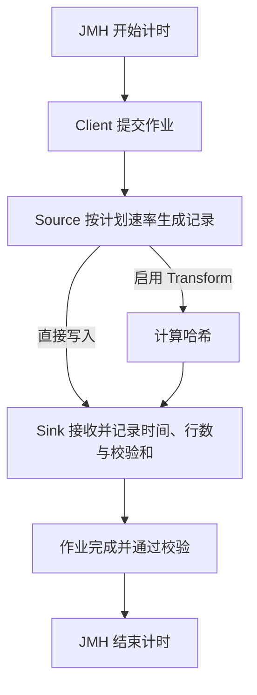

同一轮 SeaTunnel 测试，JMH 报告约 **45.4 万至 45.8 万 ops/s**，Sink 报告约 **58.8 万至 59.1 万行/秒**。JMH 把提交到完成的作业耗时折算为吞吐，Sink 只在接收数据期间计时。测试中设定的 **60 万行/秒** 则是 Source 计划生成数据的速率。

## 单节点 Pipeline 的结果

测试在 GitHub 托管的 Ubuntu 运行器上进行，使用 Java 8、4 GiB 堆、4 个 JVM 可见处理器，Pipeline 并行度为 4。每次作业处理 1,000,000 行，每行 Payload 为 256 个字符。有 Transform 的场景每行执行 64 次哈希运算。五个场景共用这组参数，分别切换 Transform、实时忙碌度观测和 StainTrace。

| 场景 | Sink 吞吐（行/秒） | P50 / P95 / P99（ms） | Max（ms） | Growth | Valid |
| --- | ---: | ---: | ---: | ---: | ---: |
| Source → Sink | 587,889.48 | 50 / 96 / 100 | 103 | 1.000 | 75/75 |
| 加 Transform | 590,318.77 | 51 / 96 / 100 | 103 | 1.000 | 75/75 |
| Transform + 忙碌度观测 | 590,667.45 | 52 / 97 / 101 | 105 | 0.990 | 75/75 |
| Transform + StainTrace | 589,970.50 | 51 / 96 / 100 | 103 | 1.000 | 75/75 |
| Transform + 忙碌度观测 + StainTrace | 589,622.64 | 52 / 97 / 101 | 105 | 0.990 | 75/75 |

表中吞吐、延迟与 Growth 取各场景测量作业的中位数。例如基础场景的 100 ms 是各次作业 P99 的中位数。五组作业的前后半段 P99 接近，每组 75 个样本都通过校验。在这轮有界作业、固定负载下，未观察到尾延迟持续增长。要估计容量上限，需要逐步提高计划速率并延长观测时间。生产环境还要计入真实连接器 I/O、多节点网络和 Checkpoint 的成本。

## 一次作业怎样计时

以 SeaTunnel 提交 `64198f4c` 的实现为例，`SeaTunnelPipelineBenchmark` 在 JMH Trial 初始化时启动单节点 Zeta Master 和 Worker。每次 invocation 通过 Client 提交一个完整的有界作业。内存 Source 按计划发数，可选的 Transform 计算哈希并写入可校验的结果，黑洞 Sink 记录接收时间、行数和 checksum。

| 指标 | 计算与计时边界 |
| --- | --- |
| JMH Score（ops/s） | 每次 invocation 计为 1,000,000 个逻辑操作。耗时包含作业配置生成、提交、调度、执行、等待完成和结果校验。集群启动在计时前完成。 |
| Pipeline Throughput（行/秒） | 处理行数除以 Sink 收到首行与末行之间的秒数。作业提交和收尾不在这个窗口内。 |
| P50 / P95 / P99、Max（ms） | 每行延迟 = Sink 接收时间 − 该行的计划生成时间，再按作业统计百分位数和最大值。 |
| Growth | `(后半段 P99 + 1) / (前半段 P99 + 1)`，两项均以毫秒计。高于 1 表示这次作业后半段尾延迟上升。 |

`BenchmarkSourceReader` 按记录序号和设定速率计算每一行的计划生成时间，`BenchmarkSinkWriter` 收到记录时用这个时间计算延迟。例如一行原计划在 100 ms 时生成，受背压影响到 110 ms 才发出，在 112 ms 到达 Sink，这一行的延迟是 12 ms。如果从实际发出时计时，就只记到 2 ms，前面等的 10 ms 会消失。

### 75/75 怎样得到

JMH 启动 3 个独立 JVM（Fork），每个先预热 3 个 iteration，再测量 5 个 iteration。一个 iteration 可以完成多个作业，因此每组 `75/75` 的分母是测量阶段实际完成的作业数。同一 Fork 内的作业共享 JIT 和堆状态，比较版本时要保留它们所属的 Fork。

`SeaTunnelEnvironmentContext` 在作业完成后校验 `processed_rows` 和 `expected_rows` 都等于计划行数。Source 直连 Sink 时 checksum 应为零，启用 Transform 后应为非零，用来发现少处理数据或跳过变换等错误。报告的 `Valid` 还要求作业符合 P99 和 Growth 阈值，并且没有延迟样本溢出直方图的统计范围。

## 用 SeaTunnelRow 微基准追查热点

整条 Pipeline 可以观察功能开关对作业的影响，`SeaTunnelRowBenchmark` 则单独计时创建、投影、复制、字段读取与大小计算。表中 Score 的单位改为 **ops/ms**，CV 为样本标准差与均值之比。

| 操作 | Score（ops/ms） | CV | 测量内容 |
| --- | ---: | ---: | --- |
| `copyPlainRow` | 22,328.74 | 1.01% | 完整复制普通 Row |
| `copyProjectedPlainRow` | 59,769.89 | 1.57% | 从 8 个字段投影复制 4 个 |
| `copyProjectedRowWithOptions` | 49,282.32 | 0.59% | 投影复制带 Options 的 Row |
| `copyRowWithOptions` | 20,789.92 | 0.22% | 完整复制带 Options 的 Row |
| `copyRowWithTracePayload` | 20,499.68 | 0.27% | 完整复制带 Trace Payload 的 Row |
| `copyThenMutateCopiedOptions` | 7,305.63 | 1.01% | 复制后修改 Options |
| `createRowAndGetBytesSize` | 5,837.52 | 0.68% | 创建 Row 并首次计算大小 |
| `createRowWithSetField` | 7,668.90 | 0.59% | 逐字段构建 Row |
| `getBytesSizeCached` | 254,677.57 | 1.13% | 读取已缓存的大小 |
| `readFields` | 28,347.47 | 0.47% | 读取并消费全部字段 |

以普通 Row 的完整复制为基线，带 Options 的复制吞吐低约 **6.9%**，带 Trace Payload 的低约 **8.2%**。回到完整 Pipeline，五种场景的 JMH Score 最大相差约 **0.87%**，各自的 Error（置信区间半宽占 Score 的百分比）为 **0.88% 至 1.38%**。这轮结果足以定位一个值得单测的复制热点，尚不足以给五种作业的性能排序。

## 如何用这组数据比较版本

固定工作负载和运行环境，保留原始 JMH JSON、逐作业 Pipeline JSON，以及 commit、JDK、JVM 参数和运行器信息。比较 baseline 与 candidate 时先检查行数和校验结果，再看各 Fork 的吞吐、P99 和 Growth。托管运行器会更换宿主机，制定回归阈值需要固定机器上的历史分布。

本实验对独立 JVM 样本的处理参考了 *Statistically Rigorous Java Performance Evaluation*（OOPSLA 2007）。*Rigorous Benchmarking in Reasonable Time*（ISMM 2013）讨论如何按 Build、Fork 和 Iteration 的方差分配重复次数。按计划生成时间跟踪尾延迟和积压的做法来自 *Benchmarking Distributed Stream Data Processing Systems*（ICDE 2018）。[三篇论文与 JMH 实践]()
