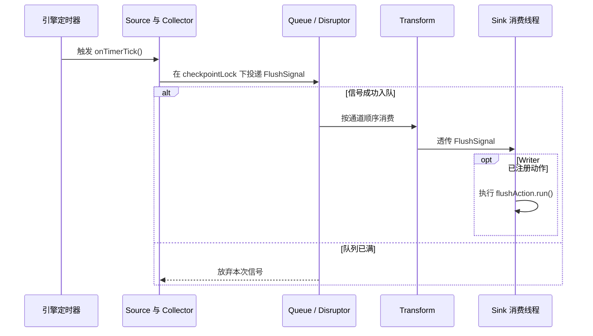

我一开始只是想给 JDBC Sink 的一批数据设个等待时间。假设 `batch_size = 1000`，`batch_interval_ms = 5000`：一张 CDC 小表更新了 3 行，随后安静了一分钟。第 5 秒，谁来把这 3 行刷出去？

批量大小很好处理。每来一条记录，`writeRecord()` 往 buffer 里加一条，攒够 1000 条就调用 `flush()`。要让那 3 行也能及时写出，还得有人在没有第 4 条记录的时候唤起 Sink。

## JDBC 里试过的两条路

最初的方案是在 Connector 里启动 `ScheduledExecutorService`，每隔 5 秒调用一次 `flush()`。Source 空闲也能刷，但同一个 buffer 有了两个使用者：Task 线程在写，定时线程在刷。checkpoint、schema 变更或 close 恰好到来时，Writer 得自己安排这些操作的先后，取消任务时还得停掉定时器。

JDBC 方案（PR #10609）的评审里，让我改主意的是**异常何时能被 Task 看见**。后台的 `executeBatch()` 失败，可以把异常存下来，在下次 `writeRecord()` 或 `prepareCommit()` 时重新抛出。偏偏在这张安静的小表上，下次写入可能很久以后才来。数据库写入已经失败，Task 却还显示 RUNNING。

后来我把时间判断移回写入线程。略去细节，逻辑是这样的：

```java
buffer.add(row);
if (buffer.size() >= batchSize
        || System.currentTimeMillis() - lastFlushTime >= batchIntervalMs) {
    flush();
}
```

这样，`flush()` 抛出的异常会沿当前调用栈传给 Task。但如果 3 行都在第 1 秒到达，第 5 秒没有人再执行这个 `if`。这批数据可能要等到下一条记录、下一次 checkpoint 或任务关闭。流量一大，写入线程频繁检查时间，这个问题就很难复现。

## STIP-23 怎样把一次定时触发交给 Sink

我在 STIP-23（Issue #10717）里把这件事拆给了两个线程。引擎的 timer 负责在时间到达时发送 `FlushSignal`，Sink 消费线程收到信号后，才执行 Connector 注册的动作。Zeta 在作业的 `env` 中读取 `sink.flush.interval`，单位是毫秒，默认 `0` 表示关闭。设为 `5000` 后，即使 Source 没读到新记录，引擎也会定时尝试发信号。



引擎实现（PR #10800）里，`SourceFlowLifeCycle` 通过 `TaskExecutionService` 注册定时器，关闭时注销。定时回调通过 `SeaTunnelSourceCollector` 向下游投递信号，线程间交接沿用传送普通记录的中间队列。Transform 对记录执行业务转换，对信号原样转发。`SinkFlowLifeCycle` 在消费线程里运行 `flushAction`，动作抛出的异常也在这条执行路径上交给 Task。

这里的 **5 秒是尝试发送的间隔**。阻塞队列用 `offer()`，Disruptor 用 `tryPublishEvent()`。如果积压已经占满队列，本次信号可以丢弃，下一次 tick 再尝试。信号成功入队后，也要等 Sink 处理完前面的记录。这个间隔与数据最终的可见延迟可能相差很大。

## 到了 checkpoint 边界，谁先执行

选择从 Source 注入，还有一个比复用队列更重要的原因。Collector 发记录和信号、Source 发 checkpoint barrier，共用同一把 `checkpointLock`。对同一条输出通道，先拿到锁并成功投递的事件排在前面。定时器和 checkpoint 同时到期时，两种先后顺序都有可能。

以 SeaTunnel 提交 `1e71be18` 中的实现为例。假设队列里依次是记录 A、`FlushSignal`、barrier。Sink 先把 A 交给 Writer，再执行已注册的 flush，随后在 snapshot barrier 的处理路径里调用 `prepareCommit()` 和 `snapshotState()`。如果 barrier 先入队，这次定时 flush 就排在它后面。即使定时信号因背压丢失，checkpoint 仍会按原有协议处理这批数据。

## Exactly-Once 下，刷出和提交各由谁决定

一个 Writer 要接入定时 flush，可以在初始化时注册自己的动作：

```java
context.registerFlushAction(this::flush);
```

没注册的 Writer 收到信号就跳过。这里必须由 Connector 选择，因为同一个 `flush()` 在不同外部系统里的含义并不一样。

以 JDBC XA 为例，如果动作只做 `statement.executeBatch()`，它把积攒的 SQL 交给当前 XA 事务，数据的最终提交仍由 checkpoint 提交协议决定。换成一个用 `stopLoad()` 结束当前 stream load 的 Sink，同样一次定时调用却可能切出新的事务边界。这样的 Writer 可以继续只在 checkpoint 路径上处理它。

回到开头那 3 行。只要 JDBC Writer 注册了动作，引擎就能在第 4 行到来之前给它一次刷出的机会。至于这 3 行什么时候能被另一条数据库连接读到，还要看 Writer 在回调里做了什么，以及对应的事务何时提交。
