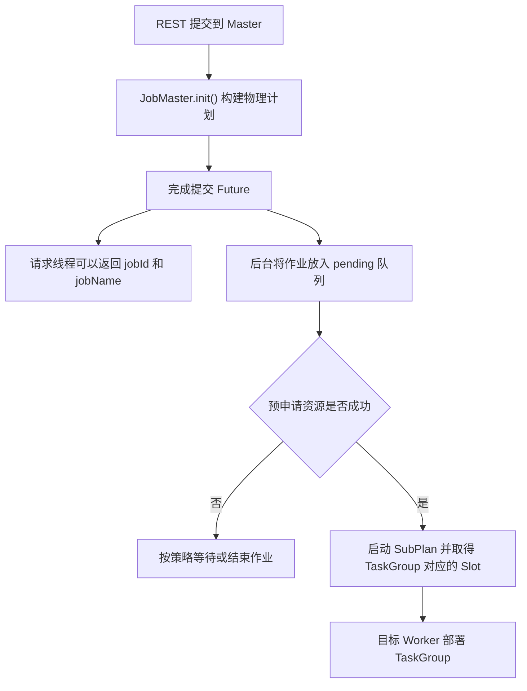

提交 SeaTunnel Zeta 作业后，HTTP 接口会返回 `jobId` 和 `jobName`。如果此时集群没有空闲 Slot，提交还能成功吗？**可以。** 在 SeaTunnel 2.3.12 中，新作业的提交请求等到 Master 完成 `JobMaster.init()` 就可以返回。资源是否足够，由另一个调度线程检查。沿着这两处等待，就能分清作业在哪里排队、哪个 Worker 最终接手执行。

## HTTP 请求等到哪一步

`SubmitJobServlet.doPost()` 读取请求体，交给 `JobInfoService.submitJob()` 解析。接收请求的节点通过 `RestJobExecutionEnvironment.build()` 构造 `JobImmutableInformation`，拿到作业 ID，随后在 `BaseService.submitJobInternal()` 判断 Master 所在的位置。如果本机就是 Master，直接调用 `CoordinatorService.submitJob()` 并 `join()`。否则，它把 `SubmitJobOperation` 发往 Master，在本机等待远端结果。两条路径在同一个协调服务会合。[REST 入口][entry] · [本地提交与远端转发][route]

`CoordinatorService` 先按 `jobId` 查找等待中或运行中的 `JobMaster`。如果找到，直接完成本次提交的 Future。对于新作业，它创建 `JobMaster`，在线程池里调用 `init()`。初始化会取得插件类加载器、还原逻辑 DAG，调用 `PlanUtils.fromLogicalDAG()` 构建物理计划与 checkpoint 计划，再初始化 checkpoint 管理器和状态 Future。[作业查找][lookup] · [作业初始化][init]

真正决定 HTTP 响应时机的是 `jobSubmitFuture.complete(null)`。这行在 `init()` 成功之后、`pendingJob.put(jobMaster)` 和写入 `PENDING` 之前。于是请求线程与后台调度可以各自向前走，客户端收到响应时作业可能仍在等待，也可能已被调度。初始化抛出的异常则通过同一个 Future 返回给提交方。[提交确认和入队的顺序][ack]

## 从排队到拿到 Slot

协调服务的 `pendingJobSchedule()` 取队首作业，调用 `JobMaster.preApplyResources()`。资源不足时，`WAIT` 策略保留队首，稍后重试。其他策略会移出该作业并按失败结束。预申请成功后，调度器才把它从等待表移到运行表，并在线程池执行 `JobMaster.run()`。因此，提交成功后长期停在 `PENDING`，可以先查队首作业的资源需求和调度策略。[等待队列与调度策略][queue]

`JobMaster.run()` 调用 `PhysicalPlan.startJob()`，将 Job 推进到 `SCHEDULED`。物理计划逐个启动仍处于 `CREATED` 的 Pipeline，每个 Pipeline 由一个 `SubPlan` 管理。进入 Pipeline 自己的 `SCHEDULED` 后，`ResourceUtils.applyResourceForPipeline()` 汇集先前预申请的 Future，为各个 `TaskGroupLocation` 取得并记录 `SlotProfile`。这个映射指明了每个 TaskGroup 要去的 Worker 和 Slot。该步骤抛出异常时，`SubPlan` 调用 `makePipelineFailing(e)`，成功时进入 `DEPLOYING`。[Job 调度][job] · [Slot 映射][slots] · [Pipeline 状态流转][pipeline]

## 哪个 Worker 执行部署

在 `DEPLOYING` 分支，`SubPlan` 先遍历协调顶点，再遍历普通顶点。对状态仍为 `CREATED` 的 `PhysicalVertex`，它调用 `startPhysicalVertex()` 和 `makeTaskGroupDeploy()`。顶点进入自己的 `DEPLOYING` 状态后，用分给它的 `SlotProfile` 调用 `deploy()`。遍历结束时，`SubPlan` 再更新 Pipeline 自己的 `RUNNING` 状态。[Pipeline 部署顺序][pipeline]

| Slot 所属位置 | 调用路径 |
| --- | --- |
| 当前节点 | `deployOnLocal()` 取得本地 Slot 的 `TaskExecutionService`，直接调用 `deployTask()`。 |
| 远端 Worker | `deployOnRemote()` 将 `DeployTaskOperation` 发给 Slot 所属节点，并以 `get()` 等待 `TaskDeployState`。目标节点在自己的 Slot 上调用 `deployTask()`。 |

Worker 重建 TaskGroup，并把任务交给本地执行线程。部署调用成功返回后，`PhysicalVertex` 才把该 TaskGroup 标为 `RUNNING`。如果 Worker 返回失败，顶点会调用 `makeTaskGroupFailing()`。这个 `RUNNING` 对应的是 TaskGroup 的部署结果，第一条记录何时抵达 Sink 还要看数据通路。[本地与远端部署][dispatch] · [顶点确认结果][vertex] · [Worker 部署][worker]

## 部署失败后谁来收尾

如果某个顶点失败，`SubPlan` 通过顶点的状态 Future 接收结果。在 `FAILING` 或 `CANCELING` 状态，它向 Pipeline 内的顶点发起取消。进入 `FAILED` 或 `CANCELED` 后，如果允许恢复并且准备成功，就释放原有资源、重新预申请并调用 `restorePipeline()`。否则，`subPlanDone()` 和 Pipeline Future 会把终态传回 Job 层。[顶点状态回调][callback] · [取消与恢复][restore]

排查一次“提交成功但没有数据”的作业，可以用 `jobId` 先定位等待队列，再按 Pipeline 查 Slot 分配记录。如果日志里已有目标 Worker 和 Slot，就到那台 Worker 上查对应的 `TaskGroupLocation` 与部署结果。这三处记录分别回答了作业是否获准调度、分到了哪里、目标节点是否完成部署。

[entry]: https://github.com/apache/seatunnel/blob/2.3.12/seatunnel-engine/seatunnel-engine-server/src/main/java/org/apache/seatunnel/engine/server/rest/servlet/SubmitJobServlet.java#L42-L47
[route]: https://github.com/apache/seatunnel/blob/2.3.12/seatunnel-engine/seatunnel-engine-server/src/main/java/org/apache/seatunnel/engine/server/rest/service/BaseService.java#L503-L558
[lookup]: https://github.com/apache/seatunnel/blob/2.3.12/seatunnel-engine/seatunnel-engine-server/src/main/java/org/apache/seatunnel/engine/server/CoordinatorService.java#L395-L399
[init]: https://github.com/apache/seatunnel/blob/2.3.12/seatunnel-engine/seatunnel-engine-server/src/main/java/org/apache/seatunnel/engine/server/master/JobMaster.java#L213-L311
[ack]: https://github.com/apache/seatunnel/blob/2.3.12/seatunnel-engine/seatunnel-engine-server/src/main/java/org/apache/seatunnel/engine/server/CoordinatorService.java#L617-L686
[queue]: https://github.com/apache/seatunnel/blob/2.3.12/seatunnel-engine/seatunnel-engine-server/src/main/java/org/apache/seatunnel/engine/server/CoordinatorService.java#L251-L328
[job]: https://github.com/apache/seatunnel/blob/2.3.12/seatunnel-engine/seatunnel-engine-server/src/main/java/org/apache/seatunnel/engine/server/dag/physical/PhysicalPlan.java#L305-L338
[slots]: https://github.com/apache/seatunnel/blob/2.3.12/seatunnel-engine/seatunnel-engine-server/src/main/java/org/apache/seatunnel/engine/server/dag/physical/ResourceUtils.java#L41-L91
[pipeline]: https://github.com/apache/seatunnel/blob/2.3.12/seatunnel-engine/seatunnel-engine-server/src/main/java/org/apache/seatunnel/engine/server/dag/physical/SubPlan.java#L623-L677
[dispatch]: https://github.com/apache/seatunnel/blob/2.3.12/seatunnel-engine/seatunnel-engine-server/src/main/java/org/apache/seatunnel/engine/server/dag/physical/PhysicalVertex.java#L263-L317
[vertex]: https://github.com/apache/seatunnel/blob/2.3.12/seatunnel-engine/seatunnel-engine-server/src/main/java/org/apache/seatunnel/engine/server/dag/physical/PhysicalVertex.java#L546-L565
[worker]: https://github.com/apache/seatunnel/blob/2.3.12/seatunnel-engine/seatunnel-engine-server/src/main/java/org/apache/seatunnel/engine/server/TaskExecutionService.java#L326-L406
[callback]: https://github.com/apache/seatunnel/blob/2.3.12/seatunnel-engine/seatunnel-engine-server/src/main/java/org/apache/seatunnel/engine/server/dag/physical/SubPlan.java#L179-L229
[restore]: https://github.com/apache/seatunnel/blob/2.3.12/seatunnel-engine/seatunnel-engine-server/src/main/java/org/apache/seatunnel/engine/server/dag/physical/SubPlan.java#L680-L712
