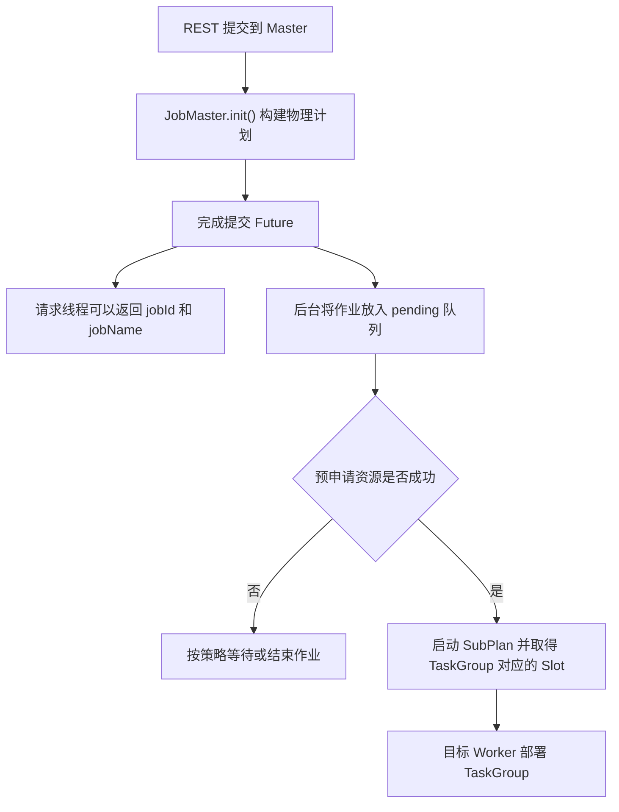

提交 SeaTunnel Zeta 作业后，HTTP 接口会返回 `jobId` 和 `jobName`。如果此时集群没有空闲 Slot，提交还能成功吗？**可以。** 在 SeaTunnel 2.3.12 中，新作业的提交请求等到 Master 完成 `JobMaster.init()` 就可以返回。资源是否足够，由另一个调度线程检查。沿着这两处等待，就能分清作业在哪里排队、哪个 Worker 最终接手执行。

## HTTP 请求等到哪一步

`SubmitJobServlet.doPost()` 读取请求体，交给 `JobInfoService.submitJob()` 解析。接收请求的节点通过 `RestJobExecutionEnvironment.build()` 构造 `JobImmutableInformation`，拿到作业 ID，随后在 `BaseService.submitJobInternal()` 判断 Master 所在的位置。如果本机就是 Master，直接调用 `CoordinatorService.submitJob()` 并 `join()`。否则，它把 `SubmitJobOperation` 发往 Master，在本机等待远端结果。两条路径在同一个协调服务会合。

`CoordinatorService` 先按 `jobId` 查找等待中或运行中的 `JobMaster`。如果找到，直接完成本次提交的 Future。对于新作业，它创建 `JobMaster`，在线程池里调用 `init()`。初始化会取得插件类加载器、还原逻辑 DAG，调用 `PlanUtils.fromLogicalDAG()` 构建物理计划与 checkpoint 计划，再初始化 checkpoint 管理器和状态 Future。

真正决定 HTTP 响应时机的是 `jobSubmitFuture.complete(null)`。这行在 `init()` 成功之后、`pendingJob.put(jobMaster)` 和写入 `PENDING` 之前。于是请求线程与后台调度可以各自向前走，客户端收到响应时作业可能仍在等待，也可能已被调度。初始化抛出的异常则通过同一个 Future 返回给提交方。

## 从排队到拿到 Slot

协调服务的 `pendingJobSchedule()` 取队首作业，调用 `JobMaster.preApplyResources()`。资源不足时，`WAIT` 策略保留队首，稍后重试。其他策略会移出该作业并按失败结束。预申请成功后，调度器才把它从等待表移到运行表，并在线程池执行 `JobMaster.run()`。因此，提交成功后长期停在 `PENDING`，可以先查队首作业的资源需求和调度策略。

`JobMaster.run()` 调用 `PhysicalPlan.startJob()`，将 Job 推进到 `SCHEDULED`。物理计划逐个启动仍处于 `CREATED` 的 Pipeline，每个 Pipeline 由一个 `SubPlan` 管理。进入 Pipeline 自己的 `SCHEDULED` 后，`ResourceUtils.applyResourceForPipeline()` 汇集先前预申请的 Future，为各个 `TaskGroupLocation` 取得并记录 `SlotProfile`。这个映射指明了每个 TaskGroup 要去的 Worker 和 Slot。该步骤抛出异常时，`SubPlan` 调用 `makePipelineFailing(e)`，成功时进入 `DEPLOYING`。

## 哪个 Worker 执行部署

进入 `DEPLOYING` 后，`SubPlan` 先部署协调顶点，再部署普通顶点。每个处于 `CREATED` 的顶点转入 `DEPLOYING`，按自己的 `TaskGroupLocation` 查出先前分配的 Slot。`PhysicalVertex.deploy()` 比较 Slot 所属 Worker 的地址与当前引擎节点的地址。这也解释了为什么同一个作业里的 TaskGroup 可以走不同的部署路径。

假设 Master 在节点 A，集群还有一个 Worker B：

| 分给 TaskGroup 的位置 | 谁来执行 |
| --- | --- |
| A 上的 Slot | A 直接从该 Slot 的上下文取得 `TaskExecutionService`，调用 `deployTask()`。 |
| B 上的 Slot | A 将任务组描述序列化，把它和 Slot 信息一起放入 `DeployTaskOperation` 发给 B。B 在指定 Slot 的上下文中调用同一个 `deployTask()`，把 `TaskDeployState` 返回给正在等待的 A。 |

目标节点按任务加载连接器所需的类，反序列化出各个 Task，重建 TaskGroup，交给本地执行线程。部署成功时，Master 将这个顶点置为 `RUNNING`。收到失败结果时，它调用 `makeTaskGroupFailing()`。因此要查 B 上的 JDBC Sink 为什么还没写出数据，先看 B 的 TaskGroup 部署日志，再看 Sink 的处理和提交记录。两者发生在不同阶段。

## 部署失败后谁来收尾

如果某个顶点失败，`SubPlan` 通过顶点的状态 Future 接收结果。在 `FAILING` 或 `CANCELING` 状态，它向 Pipeline 内的顶点发起取消。进入 `FAILED` 或 `CANCELED` 后，如果允许恢复并且准备成功，就释放原有资源、重新预申请并调用 `restorePipeline()`。否则，`subPlanDone()` 和 Pipeline Future 会把终态传回 Job 层。

排查一次“提交成功但没有数据”的作业，可以用 `jobId` 先定位等待队列，再按 Pipeline 查 Slot 分配记录。如果日志里已有目标 Worker 和 Slot，就到那台 Worker 上查对应的 `TaskGroupLocation` 与部署结果。这三处记录分别回答了作业是否获准调度、分到了哪里、目标节点是否完成部署。
